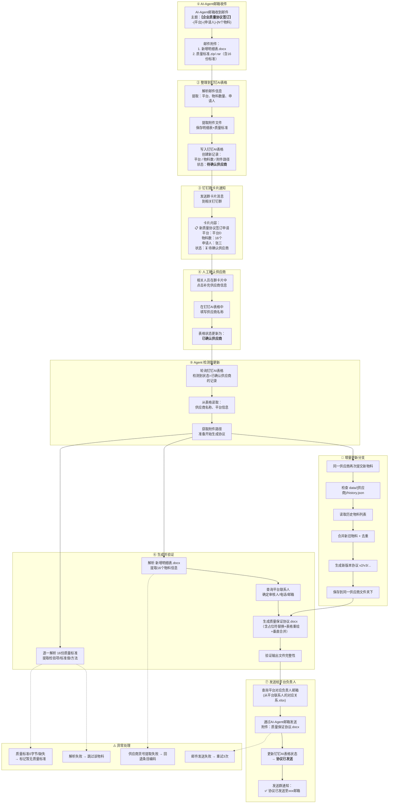

# 质量保证协议自动生成 - 全流程



---

## 一、步骤详解

### ① AI-Agent 邮箱收件

AI-Agent 邮箱收到由 OA 系统触发的邮件，包含：
- **主题格式**：`【企业质量协议签订】-{平台}-{申请人}-{N个物料}`
- **附件**：`新增明细表.docx` + `质量标准.zip`（或 .rar，内含16份标准）

> 此阶段自动完成，无需人工干预。

---

### ② 整理信息到钉钉AI表格

Agent 解析邮件后，将信息写入**钉钉AI表格**：

| 字段 | 内容 | 来源 |
|------|------|------|
| 平台 | 平台D | 邮件主题解析 |
| 物料数量 | 16 | 邮件主题解析 |
| 申请人 | 张三 | 邮件主题解析 |
| 附件路径 | data/{时间戳}/... | 文件保存路径 |
| **状态** | **待确认供应商** | 初始状态 |

---

### ③ 钉钉群卡片通知

Agent 发送群卡片消息到相关钉钉群，通知相关人员有新质量协议签订申请。

**卡片内容示例：**
```
╔══════════════════════════════╗
║  📋 新质量协议签订申请        ║
║                              ║
║  平台：平台D               ║
║  物料数：16个                 ║
║  申请人：张三                 ║
║  状态：⏳ 待确认供应商        ║
║                              ║
║  [点击补充供应商信息]         ║
╚══════════════════════════════╝
```

---

### ④ 人工确认供应商

相关人员看到群卡片后：
1. 点击卡片或进入钉钉AI表格
2. 填写/确认**供应商名称**（如"供应商A公司"）
3. 填写/确认**甲方公司**（如 示例丙公司 / 示例甲公司；决定甲方公司/地址）
4. 填写/确认**甲方联系人**（审核人，按内部联系人表配置；决定审核人/电话/邮箱）
5. 可选：补充 **OA流水号**
6. 表格状态更新为 **"已确认供应商"**

> ⚠️ **关键节点**：供应商名称以钉钉AI表格中确认为准，不从邮件解析。

---

### ⑤ Agent 检测到更新

Agent 定期轮询钉钉AI表格，检测到状态为 **"已确认供应商"** 的记录后：
1. 读取供应商名称、平台信息
2. 读取甲方公司/甲方联系人（未填写则按平台默认）
3. 获取保存的附件文件路径
4. 准备进入生成阶段

---

### ⑥ 生成并验证

```python
# 占位符替换
{1} = 供应商名称       # 从钉钉AI表格读取
{2} = 审核人           # 钉钉AI表格"甲方联系人"确认；未填时按平台查询
{3} = 联系电话          # 从平台联系人表查询
{4} = 电子邮件          # 从平台联系人表查询
{5} = 当天日期          # 自动生成
{6} = OA流水号          # 从钉钉AI表格读取（如有）

# 平台感知：优先采用钉钉AI表格确认的"甲方公司"（含示例丙公司→示例丙公司，其他→示例甲公司）
# 未填写时：平台 = 平台C → 示例丙公司，其余 → 示例甲公司
# 供应商名称以钉钉AI表格分配供应商字段为准
```

生成完成后验证：
- 表格数量 ≥ 4
- 物料数量与预期一致
- 文件可正常打开

---

### ⑦ 发送给平台负责人

1. 查询 `平台联系人的对应关系.xlsx`，获取平台负责人的邮箱
2. 通过 **AI-Agent 邮箱** 发送协议文件
3. 更新钉钉AI表格状态为 **"协议已发送"**
4. 发送群通知确认

---

### 🔄 增量更新

同一供应商分多批提交新物料时：

| 批次 | 触发 | 物料变化 | 版本 |
|------|------|---------|------|
| 第一批 | 首次邮件 | 16个物料 | v1 |
| 第二批 | 同一供应商再次提交 | +2个新增物料 | v2（18个） |
| 第三批 | 再次提交 | +3个新增物料 | v3（21个） |

增量逻辑：
```
检查 data/{供应商名}/history.json
├── 存在 → 读取历史物料列表 + 新增物料 = 合并去重 → 版本+1
└── 不存在 → 全新供应商 → 版本=1
```

### 🔄 物料升版

已有物料发生**标准变更**或**物料信息变更**时走升版分支：

```
邮件主题/附件含"升版" → 钉钉表写入"变更类型"+"升版原因"
  ↓ 人工确认供应商/甲方 → 状态：已确认供应商
  ↓ Agent轮询
读取主数据 data/_material_master.json（条目编码唯一键）
  ├─ 标准变更：新标准 hash 比对 → std_version+1 → 指标 diff（新增/删除/修改）
  └─ 信息变更：钉钉表"物料信息补充"或主数据最新信息
  ↓ 完整性门禁（名称/规格/供应商货号/品牌/存储条件/标准）
缺失 → 回写"待补全字段" → 人工补全 → 下一轮重试
  ↓ 完整
生成供应商全量协议 v+1 → history 记录 change_type/change_summaries → 发送 → 回写"协议已发送"
```

> 主数据回填：`python scripts/build_material_master.py`，输出 `data/_material_master.json` 与 `data/_master_missing_report.json`。

---

## 二、目录结构

```
supplier-doc-automation/
│
├── data/                                   ← 统一数据目录
│   ├── {供应商名称1}/
│   │   ├── materials/
│   │   │   ├── 新增明细表_v1.docx
│   │   │   ├── 质量标准_v1/
│   │   │   ├── 新增明细表_v2.docx      ← 增量
│   │   │   └── 质量标准_v2/
│   │   ├── agreements/
│   │   │   ├── QA-DOC-xxx-【生物】-供应商.docx
│   │   │   └── QA-DOC-yyy-【生物】-供应商.docx
│   │   └── history.json
│   ├── {供应商名称2}/
│   └── email_tasks/
│
├── agreement-automation/                     ← 脚本+模板
│   ├── 质量保证协议模板.docx
│   ├── 平台联系人的对应关系.xlsx
│   ├── batch_generate_v3.py
│   └── generate_qa_agreement_v3.py
│
├── scripts/                                ← 辅助脚本
├── README.md
└── AGENT.md
```

---

## 三、数据流全景

```
┌──────────────┐     ┌──────────────────┐     ┌──────────────────┐
│  OA系统触发   │────→│ AI-Agent邮箱收件   │────→│ 钉钉AI表格录入    │
│  发送邮件     │     │  解析附件          │     │  状态：待确认供应商 │
└──────────────┘     └──────────────────┘     └──────────────────┘
                                                       │
                                                       ▼
┌──────────────┐     ┌──────────────────┐     ┌──────────────────┐
│ 钉钉群卡片通知 │←────│  状态更新          │←────│ 人工确认供应商     │
│  待确认供应商  │     │  已确认供应商       │     │  填写供应商名称    │
└──────────────┘     └──────────────────┘     └──────────────────┘
                                                       │
                                                       ▼
┌──────────────┐     ┌──────────────────┐     ┌──────────────────┐
│ Agent读取表格  │────→│  生成质量保证协议   │────→│ 验证输出文件       │
│  供应商/平台   │     │  解析+重绘+合并     │     │  完整性检查        │
└──────────────┘     └──────────────────┘     └──────────────────┘
                                                       │
                                                       ▼
┌──────────────┐     ┌──────────────────┐     ┌──────────────────┐
│ 发送给平台负责人 │────→│ 更新钉钉AI表格     │────→│ 发送群通知完成     │
│  AI-Agent邮箱  │     │  状态：协议已发送   │     │  ✅ 流程结束       │
└──────────────┘     └──────────────────┘     └──────────────────┘
```

---

## 四、技术栈

```
Python 3.10+ | python-docx 1.2.0 | pandas | openpyxl | lxml
钉钉API | AI-Agent邮箱（IMAP/SMTP）
```

## 五、恢复流程

检查 `state/checkpoint.json` 的 phase：
- `CHECK_EMAIL` → 跳过邮件检查
- `WRITE_TO_DINGTALK` → 跳过表格写入
- `SEND_CARD` → 跳过群卡片
- `WAIT_CONFIRM` → 等待供应商确认（不跳过）
- `READ_FROM_DINGTALK` → 跳过表格读取
- `GENERATE` → 重新生成（若验证失败）
- `SEND_EMAIL` → 跳过发送
- `COMPLETE` → 直接返回

---

流程图版本：v3.2 | 2026年07月
